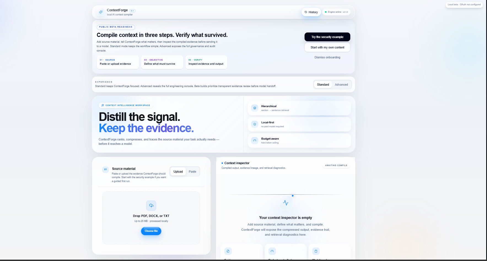

# ContextForge

**ContextForge** is a local-first AI context compiler that turns documents and pasted text into compact, task-relevant context for AI model handoff.

It helps preserve important requirements, numeric constraints, evidence provenance, and traceability while removing unnecessary context.



---

## ⬇️ Download ContextForge for Windows

### [Download ContextForge 2.1.0 — Windows x64](https://github.com/Jewel777/ContextForge/releases/download/v2.1.0/ContextForge-2.1.0-Windows-x64.zip)

**Current release:** `ContextForge 2.1.0 — First Public Beta`

> Windows x64 only. macOS builds are not available yet.

### Quick Start

1. Download `ContextForge-2.1.0-Windows-x64.zip`
2. Right-click the ZIP and choose **Extract All...**
3. Open the extracted folder
4. Double-click **`Start-ContextForge.cmd`**
5. Wait a few seconds while the local engine starts
6. ContextForge will open automatically in your browser

If the page briefly shows **Engine offline**, wait a few seconds and refresh once.

When ready, the top-right status will show:

**🟢 Engine online**

No separate Python, Node.js, or embedding-model installation is required.

---

## ⚠️ Which File Should I Download?

From the GitHub Release page, download:

```text
ContextForge-2.1.0-Windows-x64.zip
```

Do **not** download:

```text
Source code (zip)
Source code (tar.gz)
```

Those are GitHub-generated repository archives and are **not** the Windows application.

---

# What ContextForge Does

Large documents often contain far more information than an AI model actually needs for a specific task.

ContextForge helps identify, rank, compress, and preserve the evidence that matters before the context is sent to a model.

It can:

- Read PDF, DOCX, TXT, and pasted text
- Identify task-relevant evidence
- Combine semantic and lexical retrieval
- Preserve exact numeric constraints
- Protect critical requirements from being dropped
- Compress unnecessary context
- Track evidence provenance
- Show selected and rejected evidence
- Measure objective coverage
- Perform trust and evidence checks
- Produce model-ready context
- Export output for ChatGPT, Claude, Gemini, or other models

---

# How to Use ContextForge

## 1. Add Source Material

Upload a:

- PDF
- DOCX
- TXT

or choose **Paste** to enter text directly.

---

## 2. Define Your Objective

Tell ContextForge what information needs to survive the compilation.

Example:

```text
Extract all mandatory authentication and security requirements.
Preserve exact numeric limits and exclude unrelated operational details.
```

Your objective guides retrieval and evidence selection.

---

## 3. Choose a Context Budget

Set the approximate maximum amount of context you want ContextForge to retain.

This helps reduce unnecessary material before model handoff.

---

## 4. Compile

Run the compilation.

ContextForge will:

- analyze the source
- retrieve relevant evidence
- rank candidate information
- preserve critical constraints
- remove lower-value context
- produce a compact model-ready result

---

## 5. Review the Evidence

ContextForge exposes more than just the final output.

You can inspect:

- Compiled context
- Selected evidence
- Rejected evidence
- Evidence provenance
- Retrieval diagnostics
- Objective coverage
- Trust checks
- Critical-evidence preservation

This makes it easier to verify **what survived and why**.

---

## 6. Use the Result

Copy the compiled context into:

- ChatGPT
- Claude
- Gemini
- another AI model
- an agent workflow
- your own prompt pipeline

ContextForge itself does not require a paid AI model to perform local context compilation.

---

# Standard and Advanced Interfaces

ContextForge includes two interfaces.

### Standard

Designed for straightforward context compilation.

Use it when you primarily want to:

- add source material
- define an objective
- compile
- inspect the result

### Advanced

Provides deeper engineering, evidence, and governance information.

Use it when you want additional visibility into:

- retrieval behavior
- evidence selection
- rejected evidence
- provenance
- trust metrics
- objective coverage
- diagnostic information

---

# Processing Modes

ContextForge provides three context-selection modes.

### Safe

Prioritizes preserving potentially important evidence.

Best when missing a requirement would be more costly than retaining some additional context.

### Balanced

Balances compression with evidence retention.

Recommended for most general use cases.

### Aggressive

Prioritizes stronger context reduction.

Useful when context size is heavily constrained and stronger compression is desired.

---

# Key Capabilities

### Local-First Processing

Core context compilation runs locally on your computer.

### Hierarchical Retrieval

ContextForge performs retrieval across document structure rather than treating every piece of text identically.

### Semantic + Lexical Ranking

Semantic similarity and lexical evidence are combined to improve retrieval quality.

### Evidence-Aware Compression

Context is reduced while attempting to preserve the evidence most important to the objective.

### Numeric Constraint Preservation

Important numeric requirements such as:

```text
15 minutes
20 MB
5 attempts
7 days
```

are protected during compilation.

### Critical Requirement Safeguards

Mandatory requirements, prohibitions, controls, and other high-value evidence receive additional protection.

### Provenance and Traceability

Selected context can be traced back to its source evidence.

### Selected / Rejected Evidence Inspection

Users can inspect both what ContextForge kept and what it rejected.

### Trust and Objective Coverage

ContextForge provides diagnostics showing how well the compiled result covers the requested objective.

---

# Local-First Architecture

The Windows package contains everything required to run ContextForge locally:

```text
Start-ContextForge.cmd
Start-ContextForge.ps1
backend/
frontend/
models/
runtime/
```

The package includes:

- ContextForge backend engine
- ContextForge web interface
- bundled Node.js runtime
- local embedding model
- Windows startup launcher

You do **not** need to separately install:

- Python
- Node.js
- sentence-transformers
- PyTorch
- the embedding model

---

# Local Services

When ContextForge starts, it runs locally at:

### Web Interface

```text
http://127.0.0.1:3000
```

### ContextForge Engine

```text
http://127.0.0.1:8001
```

These addresses point to services running on your own computer.

---

# Windows Installation

## Step 1 — Download

Download:

```text
ContextForge-2.1.0-Windows-x64.zip
```

from the official ContextForge GitHub Release.

## Step 2 — Extract

Right-click the downloaded ZIP and select:

**Extract All...**

## Step 3 — Open the Folder

You should see:

```text
Start-ContextForge.cmd
Start-ContextForge.ps1
backend/
frontend/
models/
runtime/
```

## Step 4 — Launch

Double-click:

```text
Start-ContextForge.cmd
```

For normal use, you do **not** need to manually run `Start-ContextForge.ps1`.

## Step 5 — Wait for the Engine

Your browser should open automatically.

The embedding model may take several seconds to load during startup.

If **Engine offline** appears initially:

1. wait a few seconds
2. refresh the browser once

The status should change to:

**Engine online**

---

# Windows Security Notice

ContextForge 2.1.0 is a public beta and is not currently code-signed.

Windows may therefore display a security warning when launching the application.

Only download ContextForge from the official GitHub repository and release page.

---

# Supported Platforms

| Platform | Status |
|---|---|
| Windows x64 | ✅ Available |
| macOS Apple Silicon | 🚧 Not yet available |
| macOS Intel | 🚧 Not yet available |
| Linux | 🚧 Not yet available |

---

# Privacy

ContextForge is designed around local-first processing.

Source documents and context compilation are processed by the local ContextForge engine.

Users should still independently review the privacy requirements of any external AI service they choose to send the final compiled context to.

---

# Current Release

## ContextForge 2.1.0 — First Public Beta

The first public beta includes:

- Local document processing
- PDF, DOCX, TXT, and pasted-text input
- Hierarchical retrieval
- Semantic and lexical ranking
- Evidence-aware compression
- Numeric constraint preservation
- Critical requirement safeguards
- Provenance and traceability
- Selected/rejected evidence inspection
- Trust checks
- Objective-coverage analysis
- Safe, Balanced, and Aggressive modes
- Standard and Advanced interfaces
- ChatGPT, Claude, Gemini, and raw-context output

The application is publicly distributed as a compiled Windows build.

**Source code is maintained privately.**

---

# Feedback and Bug Reports

ContextForge is currently in **public beta**.

Feedback, bug reports, unexpected behavior, and reproducible test cases are welcome.

When reporting an issue, please include:

- ContextForge version
- Windows version
- what you attempted to do
- expected behavior
- actual behavior
- screenshots or error messages when possible

---

## Version

**ContextForge 2.1.0**

**Distill the signal. Keep the evidence.**
